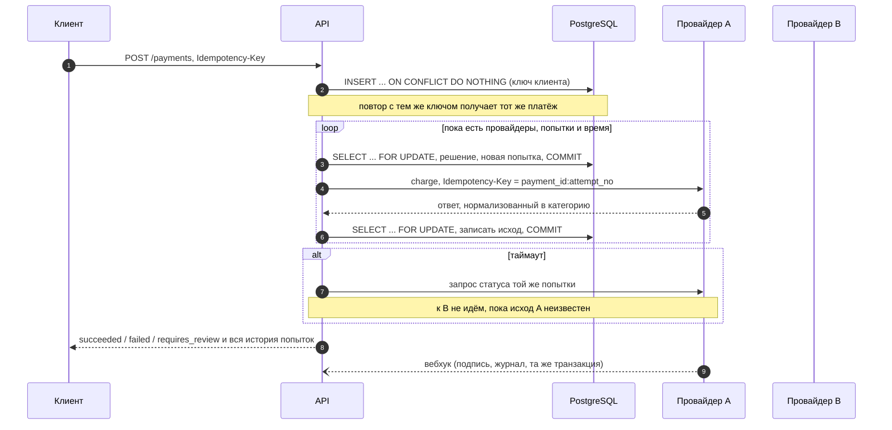
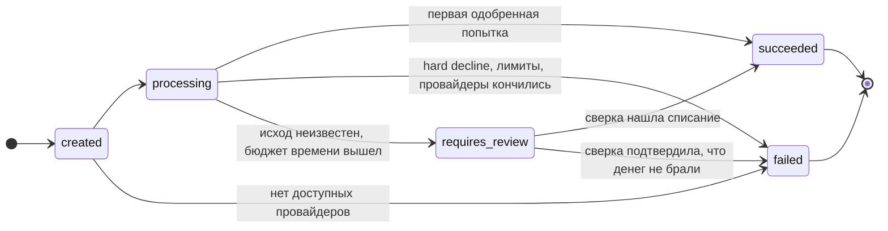
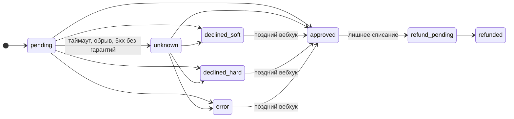

# Каскадирование платежей

Сервис принимает карточный платёж и проводит его через несколько платёжных провайдеров по очереди: если первый отказал по причине, при которой другой может одобрить, платёж уходит ко второму, и так далее. Главная забота сервиса: ни при каком сбое не списать деньги дважды и не потерять списание.

Стек: Python 3.13, FastAPI, PostgreSQL (SQLAlchemy 2 + asyncpg, Alembic), Redis, Taskiq (через Redis Streams), httpx, Pydantic, Poetry, Ruff, Docker, Gunicorn + Uvicorn workers. Архитектура: модульный монолит, модуль `payments` разделён на слои domain / application / infrastructure / api.

## Быстрый старт

```bash
docker compose up --build
```

Поднимаются Postgres, Redis, миграции, API (`localhost:8080`, Swagger на `/docs`), воркер и планировщик Taskiq и мок-провайдеры (`localhost:9000`). Ключи не нужны: всё работает на мок-провайдерах. Если порты заняты, их можно поменять в `.env` (см. `.env.example`).

Посмотреть логику глазами: демо-страница `http://localhost:8080/demo/` или `http://127.0.0.1:8080/demo/`. Там кнопки по сценариям. По каждому платежу видно, к какому провайдеру ходил сервис, что тот ответил и почему каскад пошёл дальше или остановился. Для долгих сценариев (поздний вебхук, зависший платёж) страница следит за платежом, пока работу доделывают фоновые задачи. Сбоку состояние circuit breaker и статистика провайдеров. Своей логики у страницы нет: это HTML и JS, которые вызывают тот же публичный API. Выключается настройкой `DEMO_PAGE_ENABLED=false`.

Прогнать все сценарии против поднятого стека (настоящие HTTP-вызовы, таймауты, вебхуки, фоновые задачи):

```bash
docker compose exec api python -m scripts.demo          # около 30 секунд
docker compose exec api python -m scripts.demo --slow   # плюс сценарий с ручной проверкой, около 2 минут
```

Тесты (юнит, интеграционные и сценарные на настоящих Postgres и Redis) и линтер:

```bash
docker compose --profile test run --rm tests
docker compose --profile test run --rm tests ruff check .
```

## Задача и допущения

Задание: спроектировать систему каскадирования платежей. Я сделал рабочий сервис и описал решения в этом файле.

Допущения:

- Платёж одностадийный (списание сразу, без отдельных авторизации и подтверждения). Почему это важно для возвратов, написано в разделе «Что не сделано».
- Клиент ждёт ответ синхронно. Бюджет времени по умолчанию 15 секунд. Ответ может прийти позже бюджета: запрос к провайдеру, начатый до конца бюджета, не обрывается. У мок-провайдеров таймаут 3 секунды, у Stripe 10, а проверка статуса у Stripe может состоять из двух запросов подряд (поиск и повтор). Всё, что не успело выясниться, доделывают фоновые задачи.
- Карта приходит не номером, а токеном (см. раздел про PCI DSS). Номер карты API не примет, в том числе спрятанный внутри токена.
- Провайдеров три мок-провайдера (alpha, beta, gamma) и Stripe в тестовом режиме, если задан ключ.
- Сумма передаётся в минорных единицах (центах) целым числом, рядом всегда валюта.

## Как устроено

```text
app/
  core/                      настройки, логирование, БД
  modules/payments/
    domain/                  Pydantic-сущности и правила, без I/O
      entities.py            Payment (агрегат) и PaymentAttempt, машины состояний
      policy.py              решение о следующем шаге каскада (чистая функция)
      routing.py             правила маршрутизации
      money.py, outcome.py   деньги, нормализованный ответ провайдера
    application/             сценарии (use cases) и порты
      process_payment.py     цикл каскада
      create_payment.py      создание с Idempotency-Key
      webhooks.py            приём вебхуков
      background.py          сверка неизвестных исходов, возвраты, восстановление
    infrastructure/
      db/                    таблицы и репозитории (SQLAlchemy Core)
      providers/             адаптеры провайдеров на httpx, тестовый vault
      circuit_breaker.py     circuit breaker в Redis
      tasks/                 Taskiq: брокер, планировщик, задачи
    api/                     FastAPI-роутеры
    bootstrap.py             сборка зависимостей
  demo/                      демо-страница: HTML и JS поверх публичного API
mock_psp/                    отдельный сервис с мок-провайдерами
migrations/                  Alembic
tests/                       unit/ и integration/
scripts/demo.py              прогон сценариев против живого стека
```

Домен не знает про БД и HTTP. Провайдеры спрятаны за портом `PaymentProvider` (`charge`, `get_status`, `refund`, `parse_webhook`). Добавить провайдера значит написать адаптер и строку в фабрике.

### Поток платежа



Каждый шаг каскада это короткая транзакция: заблокировать строку платежа, решить, записать, закоммитить. Сетевой вызов провайдера идёт между транзакциями, поэтому во время него не держится ни блокировка, ни соединение с БД.

### Машины состояний

Переходы есть только в методах сущностей. Недопустимый переход бросает `InvalidStateTransition`; таблицы переходов проверяются юнит-тестом на всех парах состояний.





Переходы «отказ → approved» выглядят странно, но они нужны: если провайдер сначала сказал «не списали», а потом вебхуком «списали», деньги реально ушли, и это надо записать, а не потерять из-за строгой машины состояний. Такая попытка помечается `late_approval`, дальше платёж решает, оставить её или вернуть деньги.

## Ключевые решения

### Когда каскадировать

Каждый адаптер переводит коды своего провайдера в одну из категорий. У alpha коды в стиле ISO 8583 (`05`, `43`, `96`), у beta и gamma строковые (`do_not_honor`, `stolen_card`), у Stripe свои `decline_code`. Таблицы лежат в адаптерах (`ALPHA_CODES`, `BETA_CODES`, `STRIPE_CODES`).

| Категория | Примеры | Деньги списаны? | Что делаем |
|---|---|---|---|
| approved | `00`, `captured`, `succeeded` | да | платёж успешен |
| soft decline | do not honor, generic decline, issuer unavailable | нет | следующий провайдер |
| hard decline | stolen, lost, fraud, invalid/expired card, insufficient funds | нет | стоп, каскада нет |
| technical error | запрос на списание не ушёл (не удалось соединиться) или отклонён до обработки; ответ, в котором провайдер по контракту гарантирует «не обработано» | нет | следующий провайдер |
| unknown | таймаут чтения, обрыв после отправки, 5xx без гарантий, «processing» | неизвестно | спросить статус у того же провайдера |

Решения, которые можно оспорить, и почему я выбрал так:

- **Недостаток средств считаю hard decline.** За любым эквайером стоит тот же банк-эмитент, денег на карте от смены провайдера не прибавится, а повторы по такой карте платёжные системы не любят.
- **Неизвестный код отказа считаю hard decline** и пишу в лог `unmapped_decline_code`. Деньги при отказе не списаны, но причину мы не знаем, и молча гонять карту по провайдерам хуже, чем один раз недополучить конверсию. Код потом добавляют в таблицу.
- **Ошибка соединения безопасна, таймаут чтения нет.** Если TCP-соединение не установилось, запрос точно не ушёл. Если запрос отправлен и ответ не пришёл, провайдер мог его обработать. Это различие зашито в `infrastructure/providers/base.py`.
- Лимиты: не больше 3 попыток, каждый провайдер не больше одного раза за платёж, общий бюджет 15 секунд. Новая попытка не начинается, если до конца бюджета меньше 3 секунд.

### Таймаут: почему не идём к следующему провайдеру

Таймаут не значит отказ. Если после таймаута у A сразу пойти к B, а A на самом деле списал, клиент заплатит дважды. Поэтому:

1. Попытка переходит в `unknown`. Политика (`domain/policy.py`) в этом состоянии разрешает только одно действие: спросить статус у того же провайдера.
2. Статус спрашивается с нарастающей паузой, пока не кончится бюджет времени. Пока мы ждём, исход может прийти вебхуком, это тоже учитывается. Если не удался сам запрос статуса (нет соединения, таймаут, ответ 4xx или 5xx), это не ответ про платёж: попытка остаётся `unknown`. Для запроса на списание «не удалось соединиться» значит «точно не списано», а для запроса статуса только то, что вопрос не задан. Если перепутать, после отказа запроса статуса каскад пошёл бы к следующему провайдеру и списал бы второй раз (`unanswered_status_query` в `providers/base.py`).
3. Ответ «такого платежа нет» считается «не списано» только у провайдеров, которые по контракту сохраняют ссылку на запрос в момент приёма (так устроены мок-провайдеры; на том же контракте держится и то, что их ответы 4xx на запрос списания значат «запрос не обработан»). И только если это собственный ответ провайдера (`{"detail": "not_found"}`): 404 от прокси или с неверного пути ничего не говорит о платеже. У Stripe так нельзя, поэтому порядок другой: если id платежа известен, читаем его; иначе ищем платёж по нашему ключу попытки в метаданных; если не нашли и попытке меньше часа, повторяем тот же запрос с тем же `Idempotency-Key`. Stripe либо вернёт сохранённый результат первого запроса (он хранит и ошибки, даже 500), либо, если первый запрос до него не дошёл, выполнит его один раз. Ключи Stripe хранит 24 часа, после этого повтор стал бы новым списанием, поэтому старые попытки не повторяются, а остаются «неизвестными» до ручного разбора. Кроме того, повтор делается только пока идёт каскад и клиент ждёт ответа. Фоновая сверка запрос не повторяет: клиенту уже ответили, и если первый запрос до Stripe не дошёл, повтор стал бы первым списанием спустя время, которого никто не ждёт. Фоновые проверки статуса поэтому только читают.
4. Если исход так и не выяснился, платёж переходит в `requires_review`, клиент получает этот статус. Фоновая задача продолжает спрашивать провайдера, всё реже со временем. Нашла списание: платёж `succeeded`. Подтвердилось, что денег не брали: `failed`. То же самое происходит, если ответ принёс вебхук. После 30 безуспешных проверок пишется алерт `review_stuck` для ручного разбора.

Каскад после `requires_review` не возобновляется: клиент уже получил ответ, а новая попытка без него была бы сюрпризом.

### Защита от двойного списания

Несколько независимых уровней:

1. **Ключ клиента.** `Idempotency-Key` обязателен. Уникальный индекс `(customer_id, idempotency_key)`, вставка через `INSERT ... ON CONFLICT DO NOTHING`. Два одновременных запроса с одним ключом: второй ждёт коммита первого на уникальном индексе и получает уже созданный платёж. Повтор после завершения возвращает тот же платёж в его текущем состоянии (`200`, заголовок `Idempotent-Replayed: true`): если первый ответ был `requires_review`, повтор может уже показать `succeeded`. Тот же ключ с другим телом: `422` с кодом `idempotency_key_reused`. Если первый запрос ещё выполняется: `409` и `Retry-After` (как в черновике IETF про Idempotency-Key). Без ключа `400`, ключ короче 8 символов не пройдёт валидацию (`422`).
2. **Ключ попытки.** Каждая попытка уходит к провайдеру с ключом `payment_id:attempt_no`. Ретрай того же запроса провайдер дедуплицирует сам. Уникальность `(payment_id, attempt_no)` в БД.
3. **Одна неясная попытка на платёж, гарантия на уровне БД.** Частичный уникальный индекс `payment_attempts(payment_id) WHERE status IN ('pending','unknown')`. Даже если в коде появится ошибка, вторую попытку, пока исход первой не ясен, в базу не записать (есть тест).
4. **Блокировка строки платежа.** Все изменения платежа и его попыток идут под `SELECT ... FOR UPDATE`. Ответ провайдера, вебхук и фоновая задача не могут одновременно продвинуть один платёж.
5. **Первое одобрение побеждает.** Любое следующее одобрение того же платежа считается лишним списанием: попытка уходит в `refund_pending`, пишется алерт `extra_charge`, задача возврата запускается сразу. Возврат идёт с ключом `refund:payment_id:attempt_no`, поэтому повторный запуск задачи второй раз деньги не вернёт.

### Поздний вебхук

Сценарий из задания: A ответил «не обработано», мы ушли к B, B одобрил, а потом от A приходит вебхук «одобрено». Что происходит:

- вебхук проходит проверку подписи и пишется в журнал;
- попытка A переходит `error → approved` с флагом `late_approval`;
- у платежа уже есть победитель (B), поэтому A уходит в `refund_pending`, пишется алерт `extra_charge`;
- Taskiq-задача делает возврат у A, попытка становится `refunded`. Мок-провайдер показывает этот возврат в `/_admin/charges`.

Если поздний вебхук пришёл, пока попытка у B ещё в полёте, побеждает A (он записан первым), а одобрение B потом вернётся тем же механизмом. Если B при этом ответил таймаутом или процесс упал во время запроса к B, платёж уже `succeeded`, но попытка B остаётся неясной: фоновая сверка продолжает спрашивать B и про такие попытки, и если B тоже списал, деньги возвращаются. Если платёж уже `failed` (клиенту сказали «не прошло»), позднее списание тоже возвращается.

### Вебхуки

- Отдельный URL на провайдера: `/webhooks/mock_alpha`, `/webhooks/mock_beta`, `/webhooks/mock_gamma`, `/webhooks/stripe`. У каждого свой секрет и своя схема подписи. Подпись проверяется по сырому телу до разбора JSON. У beta и Stripe подпись включает метку времени, вебхук старше 5 минут отклоняется (защита от повтора).
- Сырое событие пишется в `webhook_events` с уникальным `(provider, event_id)`. Таблица только на добавление: `UPDATE` и `DELETE` запрещены триггером в БД.
- Запись в журнал и изменение платежа идут в одной транзакции. Дубль события (провайдеры шлют повторно) отсекается уникальным индексом, в том числе когда дубли приходят одновременно.
- Попытку может закрыть только вебхук её собственного провайдера.

### Маршрутизация и circuit breaker

Правила лежат в таблице `routing_rules` (валюта, страна, метод, диапазон суммы, упорядоченный список провайдеров, приоритет). Берётся первое подходящее по приоритету правило. Из списка выкидываются провайдеры, которые не настроены, не поддерживают валюту или для которых в vault нет токена этой карты. Для демо заведены три правила: US сначала через Stripe, EUR сначала через beta, остальное alpha → beta → gamma.

Circuit breaker общий для всех процессов, живёт в Redis: скользящее окно 60 секунд из корзин по 10 секунд. Ошибкой считаются только `error` и `unknown`; отказ банка это нормальный ответ, а не болезнь провайдера. Если в окне не меньше 10 запросов и доля ошибок не меньше 50%, провайдер выключается на 30 секунд, потом окно начинается заново. Если Redis недоступен, breaker пропускает трафик: платежи не должны вставать из-за него.

### Фоновые задачи (Taskiq)

Брокер `RedisStreamBroker` (подтверждение после выполнения задачи), планировщик `TaskiqScheduler` с расписанием из меток задач:

| Задача | Интервал | Что делает |
|---|---|---|
| `payments.reconcile_unknown` | 15 с | спрашивает статус попыток `unknown` у всех платежей, которые сейчас не в обработке: `requires_review`, а также `succeeded`/`failed`, если платёж закрыла другая попытка |
| `payments.execute_refunds` | 10 с, плюс сразу после обнаружения лишнего списания | делает возвраты `refund_pending` |
| `payments.recover_stale` | 30 с | подбирает платежи, брошенные упавшим процессом |

Источник правды это БД, а не очередь. Сверка и возвраты забирают работу через `UPDATE ... WHERE id IN (SELECT ... FOR UPDATE SKIP LOCKED)` с арендой на 60 секунд: несколько воркеров не возьмут одну попытку одновременно, а потерянная задача просто подхватится следующим запуском. Заодно блокируется строка платежа, чтобы параллельное сохранение платежа не затёрло аренду. `recover_stale` устроен проще: находит кандидатов обычным запросом, берёт каждый платёж под `FOR UPDATE` и перепроверяет условие уже под блокировкой. Если воркер обрабатывает попытку дольше аренды, её может взять второй; это безопасно, потому что запрос статуса ничего не меняет, а возврат идёт с ключом идемпотентности. Отдельный outbox для задач поэтому не нужен.

Если API упал посреди каскада, попытка остаётся `pending`, и мы не знаем, ушёл ли запрос. `recover_stale` переводит её в `unknown` (даже если сам платёж к этому времени уже закрыт другой попыткой) и дальше работает обычная логика: статус у того же провайдера, слепого повтора нет.

### Деньги

Сумма хранится как `BIGINT` в минорных единицах, валюта отдельным полем рядом. В API `amount` строго целое: `19.99` и `"1999"` отклоняются. В коде нет ни одного float для денег.

### Безопасность и PCI DSS

- Номера карт сервис не принимает и не хранит. В API приходит только токен (`tok_...`). Шаблон поля не пропустит номер карты, а проверка на 12 и больше цифр подряд не пропустит его и внутри токена (`tok_4242424242424242`).
- В реальности каскад карточных платежей между провайдерами требует, чтобы данные карты были доступны каждому из них. Токен одного провайдера другой не примет. Варианты: PCI DSS-сертифицированное хранилище карт (своё, что означает полный аудит PCI DSS, или внешний vault) или network tokens от платёжных систем. Здесь эту роль играет `TestTokenVault`: он отдаёт мок-провайдерам тестовый токен как есть, а для Stripe сопоставляет его с тестовыми PaymentMethod (`pm_card_visa`, `pm_card_chargeDeclinedStolenCard` и так далее).
- Ключи Stripe читаются только из окружения (`.env`), в коде и репозитории их нет. Ключи живого режима (`sk_live_`) отклоняются при старте.
- Секреты мок-провайдеров в `docker-compose.yml` это учебные значения только для локального запуска.

### Наблюдаемость

- Логи в JSON, в каждой строке каскада есть `payment_id`, `attempt_no`, `provider`, исход, код провайдера и время ответа.
- `GET /payments/{id}` отдаёт всю историю попыток: провайдер, статус, код и сообщение провайдера, число проверок статуса, флаг позднего одобрения, id возврата.
- `GET /stats/providers?window_minutes=60`: попытки по исходам, approval rate (одобрения к ответам банка, без технических ошибок), доля технических ошибок и состояние circuit breaker.
- `GET /alerts`: лишние списания, поздние одобрения, неудачные возвраты, зависшие проверки. Каждый алерт также пишется в лог с уровнем `error`.

## Сценарии

Сценарий выбирается тестовым токеном карты. Поведение задано в `mock_psp/scenarios.py`, без случайностей.

| Токен | Что делают провайдеры | Результат |
|---|---|---|
| `tok_approve` | alpha одобряет | succeeded на alpha |
| `tok_soft_decline` | alpha: `05` do not honor | alpha soft → beta одобряет |
| `tok_hard_decline` | alpha: `43` stolen card | failed, каскада нет |
| `tok_insufficient_funds` | alpha: `51` | failed, каскада нет |
| `tok_all_soft` | все три soft decline | failed после 3 попыток |
| `tok_timeout_approved` | alpha отвечает через 10 с (таймаут клиента 3 с), но списывает | проверка статуса нашла списание, succeeded на alpha, beta не вызывается |
| `tok_timeout_not_processed` | alpha таймаут, по статусу «не обработано» | alpha error → beta одобряет |
| `tok_timeout_stuck` | alpha таймаут и минуту в «processing», без вебхука | requires_review, затем фоновая сверка: succeeded |
| `tok_late_webhook` | alpha: 503 «не обработано», через 3 с вебхук «одобрено» | succeeded на beta, лишнее списание alpha возвращено, алерт |
| `tok_beta_server_error` | alpha soft, beta 500 без гарантий (но списал) | статус у beta: succeeded на beta |
| `tok_alpha_down` | alpha всегда 503 | beta; после серии таких платежей alpha выключается breaker'ом |

В трёх сценариях с таймаутом и 500 мок нарочно шлёт вебхук через 5 секунд, позже нашей проверки статуса. Проверка статуса уходит примерно через полсекунды после таймаута или ответа 500 и успевает раньше вебхука: у попытки `status_checks` больше нуля, а вебхук приходит потом как повтор (в логе API `webhook_processed` с `changed: false`). Если вебхук приходит раньше, платёж закрывает он, а ответ по HTTP уже ничего не меняет: это тоже штатный путь.

Примеры с curl (API на `localhost:8080`):

```bash
curl -s -X POST localhost:8080/payments \
  -H 'Content-Type: application/json' -H 'Idempotency-Key: demo-0001' \
  -d '{"customer_id":"cust_1","amount":1999,"currency":"USD","country":"DE","payment_method":{"type":"card","token":"tok_soft_decline"}}'
```

```bash
curl -s localhost:8080/payments/<id>
```

```bash
curl -s localhost:8080/stats/providers
```

```bash
curl -s 'localhost:8080/alerts?limit=10'
```

```bash
curl -s 'localhost:9000/_admin/charges?reference_prefix=<id>'
```

Последняя команда показывает, что про платёж думают сами мок-провайдеры: сколько списаний и возвратов они сделали.

Пример ответа для `tok_soft_decline` (сокращён):

```json
{
  "status": "succeeded",
  "amount": 1999,
  "currency": "USD",
  "route": ["mock_alpha", "mock_beta", "mock_gamma"],
  "succeeded_provider": "mock_beta",
  "attempts": [
    {"attempt_no": 1, "provider": "mock_alpha", "status": "declined_soft", "provider_code": "05", "provider_message": "Do not honor"},
    {"attempt_no": 2, "provider": "mock_beta", "status": "approved", "provider_code": "captured"}
  ]
}
```

### Краш-тест: процесс API упал посреди платежа

Платёж с `tok_timeout_stuck` (alpha молчит), через 2 секунды процесс API убивается:

```bash
curl -s -X POST localhost:8080/payments \
  -H 'Content-Type: application/json' -H "Idempotency-Key: crash-$(date +%s)" \
  -d '{"customer_id":"cust_1","amount":1999,"currency":"USD","country":"DE","payment_method":{"type":"card","token":"tok_timeout_stuck"}}' \
  >/dev/null & sleep 2; docker compose kill api
```

В БД остаётся платёж `processing` с попыткой `pending`: запрос к alpha ушёл, а записать ответ некому.

```bash
docker compose exec postgres psql -U payments -c "select p.id, p.status, a.provider, a.status from payments p join payment_attempts a on a.payment_id = p.id order by p.created_at desc limit 1"
```

API поднимается обратно командой `docker compose start api`. Именно `start`: `up` пересоздаст и контейнер мок-провайдеров, а они держат состояние в памяти и «забудут» списание. Примерно через минуту фоновая задача находит брошенный платёж, переводит попытку в `unknown`, а платёж в `requires_review`. К beta она не идёт. Alpha в этом сценарии проводит платёж через минуту после запроса, и в пределах минуты после этого фоновая сверка узнаёт о списании: платёж становится `succeeded`. В `_admin/charges` по этому платежу одно списание у alpha и ни одного у beta.

## Stripe в тестовом режиме

1. Завести аккаунт Stripe, в режиме Test mode взять секретный ключ `sk_test_...` (Developers → API keys).
2. Скопировать `.env.example` в `.env` и вписать `STRIPE_SECRET_KEY`.
3. `docker compose up --build`. В `/health` в списке провайдеров появится `stripe`.
4. Платёж с `"country": "US"` пойдёт по правилу «сначала Stripe»: `tok_approve` одобрит Stripe, `tok_soft_decline` получит у Stripe `generic_decline` и уйдёт дальше по маршруту (alpha с этим токеном тоже откажет мягко, и платёж пройдёт через beta), `tok_hard_decline` получит `stolen_card` и остановится.

Вебхуки Stripe (необязательно): `stripe listen --forward-to localhost:8080/webhooks/stripe`, выданный секрет `whsec_...` вписать в `STRIPE_WEBHOOK_SECRET`.

Без ключа Stripe просто не регистрируется, и правило для US идёт через alpha и beta.

## Тесты

Запуск: `docker compose --profile test run --rm tests`. В GitHub Actions два джоба: тесты с линтером на сервисах Postgres и Redis, и подъём всего стека через `docker compose` с прогоном `scripts/demo.py`.

- **Юнит** (`tests/unit`): машины состояний (все пары переходов), агрегат платежа, политика каскада, маршрутизация, деньги; адаптеры alpha и beta против настоящего приложения мок-провайдера в процессе (коды, таймауты, статус, идемпотентность, возвраты, подписи); классификация сетевых ошибок; сбой самого запроса статуса (нет соединения, 401, 429, 404 не от провайдера, неудачный повтор у Stripe) оставляет исход неизвестным; повтор у Stripe только пока идёт каскад; длинные значения провайдера обрезаются до размера колонок; номер карты внутри токена отклоняется; мусор в заголовках подписи даёт 400, а не 500; адаптер Stripe на заготовленных ответах API (в том числе поиск статуса и запрет повтора для старых попыток).
- **Интеграционные и сценарные** (`tests/integration`, настоящие PostgreSQL и Redis): A soft → B; A hard → стоп; таймаут и «списано» → без каскада; таймаут и «не обработано» → каскад; `requires_review` и фоновая сверка в обе стороны; вебхук с отказом закрывает `requires_review`; поздний вебхук → возврат лишнего; поздний вебхук, пока попытка у B в полёте, и B тоже списал → возврат B; неудачный возврат → повтор и алерт; падение адаптера; открытый breaker; восстановление после падения процесса, в том числе когда платёж уже закрыт другой попыткой; пять одновременных запросов с одним ключом → один платёж и одно списание; одновременные вебхуки (дубли и разные события) → состояние продвигается один раз; одновременные поздние одобрения → один возврат; триггер append-only; запрет второй неясной попытки на уровне БД; демо-страница отдаётся и выключается настройкой.

## Что сознательно не сделано и как бы делал в проде

- **Двухстадийная оплата (авторизация и подтверждение).** С ней лишнюю авторизацию можно отменить (void) до списания, и клиент вообще не увидит второй суммы. Здесь одностадийное списание, поэтому лишнее только возвращается. В проде я бы делал auth/capture там, где провайдер позволяет.
- **3-D Secure.** Ответ «нужна аутентификация» сейчас останавливает каскад. В проде это отдельный поток с возвратом клиента на страницу банка.
- **Код «дубликат транзакции».** ISO-код `94` у alpha не внесён в таблицу и поэтому считается неизвестным кодом, то есть жёстким отказом. Правильнее отправлять его на проверку статуса: такой ответ может значить, что провайдер уже провёл эту транзакцию, и тогда «отказ» скроет списание.
- **Подсказки «не повторять» от платёжных систем.** Mastercard присылает Merchant Advice Code (03: счёт закрыт или подозрение на мошенничество, 21: клиент отменил регулярные платежи), Stripe присылает `advice_code: do_not_try_again`. Сервис их не читает, поэтому мягкий отказ с такой подсказкой уйдёт к следующему провайдеру, а за повтор после MAC 03 и 21 Mastercard берёт плату. В проде такая подсказка должна превращать отказ в жёсткий.
- **Лимит повторов по одной карте между платежами.** Внутри платежа не больше 3 попыток, но новые платежи с той же картой клиент может создавать без ограничений. У Visa и Mastercard есть правила о числе повторов по карте за 30 дней и плата за превышение. В проде нужен счётчик отказов по токену карты и пауза после жёсткого отказа.
- **Сверка суммы в одобрении.** Сумма и валюта из ответа провайдера не сравниваются с запрошенными. Частичное одобрение (эмитент одобрил меньше, чем просили) мы не запрашиваем, так что ждать его не нужно. Но при расхождении правильно писать алерт и отправлять платёж на ручную проверку, а не считать его оплаченным.
- **Двойное нажатие с разными ключами** создаст два платежа: ключ идемпотентности защищает только от повтора того же запроса. Ключ должен создавать клиент, один на оформление заказа. На сервере можно дополнительно предупреждать о похожем платеже того же клиента за последние минуты.
- **Авторизация API (JWT) и привязка `customer_id` к пользователю.** Сейчас `customer_id` приходит в теле.
- **Нагрузочное тестирование не проводилось**, цифр производительности нет. Что сделано с расчётом на нагрузку: в БД нет блокировок и соединений во время сетевых вызовов, у каждого провайдера свой пул соединений httpx, фоновые задачи масштабируются горизонтально через `SKIP LOCKED`.
- **Планировщик Taskiq в одном экземпляре.** Два планировщика будут ставить задачи дважды; это безопасно (задачи забирают работу из БД), но лишняя нагрузка. В проде один планировщик или блокировка лидера.
- **Хранение.** Ключи идемпотентности и журнал вебхуков хранятся бессрочно. В проде нужен срок хранения и архив (журнал вебхуков разумно партиционировать по времени).
- **Число знаков после запятой у валют.** Сумма принимается в минорных единицах как есть, без проверки, что у JPY их ноль, а у KWD три.
- **Частичные возвраты, чарджбэки, выплаты** вне рамок задачи.
- **Сверки с реестрами провайдеров нет.** Повторно опрашиваются только попытки с неизвестным исходом. Если провайдер ответил отказом, а потом всё-таки списал и не прислал вебхук, это найдёт только ежедневная сверка по его отчёту (settlement report): списание есть у провайдера, а у нас попытка с отказом. В проде такая сверка нужна по каждому провайдеру.
- **Сломанные ключи провайдера (401, 403).** На запрос списания это обычный технический сбой: платёж уходит к следующему провайдеру, предохранитель со временем выключает этого. На запрос статуса исход остаётся неизвестным, и платёж уходит на ручную проверку. Отдельного алерта нет, хотя это ошибка нашей настройки, о которой нужно узнать сразу.
- **Алерты** пишутся в таблицу и в лог. В проде их отправляли бы в мониторинг (Sentry, PagerDuty, Telegram), а на `extra_charge` и `refund_failed` вешали бы дежурного.
- **Мок-провайдеры** держат состояние в памяти, после перезапуска контейнера оно сбрасывается.
- **Адаптер Stripe** проверен тестами на заготовленных ответах Stripe API. С настоящим тестовым аккаунтом Stripe я его не прогонял: для этого нужен ключ (раздел выше).
- **Возврат Stripe в статусе `pending`** считается выполненным, а события `refund.failed` и `charge.refund.updated` не обрабатываются. Если такой возврат позже не пройдёт, сервис об этом не узнает. В проде нужно сохранять id возврата, дочитывать его статус до `succeeded` и слушать эти события, а при неудаче писать алерт `refund_failed`.
